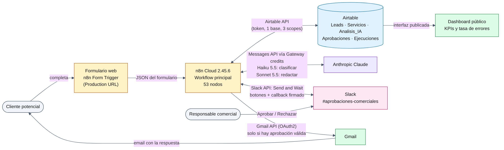

# DataPyme · Ecosistema de automatización IA para consultas comerciales

Proyecto final del curso **IA Automation** (CoderHouse) · Damián Córdoba · Octubre de 2026

Sistema que recibe consultas comerciales, las clasifica y redacta la primera respuesta con IA, **espera la aprobación de una persona en Slack** y recién entonces envía el email al cliente. Todo queda registrado en Airtable y se monitorea en un dashboard público.

> **Negocio ficticio:** *DataPyme Consultores* es una consultora inventada de sistemas Excel y Power BI para pymes. Todos los datos de clientes son de prueba.

| | |
|---|---|
| 📄 **Documento de arquitectura (PDF)** | [`docs/arquitectura.pdf`](docs/arquitectura.pdf) |
| ⚙️ **Workflow n8n (JSON)** | [`workflow/datapyme-consultas-comerciales.json`](workflow/datapyme-consultas-comerciales.json) |
| 🗄️ **Base de datos (solo lectura)** | [Airtable · DataPyme - Consultas Comerciales](https://airtable.com/appQ2tpIxoHn0JjBS/shrOjp0raR5VZJpRS) |
| 📊 **Dashboard de control** | [Tablero de control (KPIs y tasa de errores)](https://airtable.com/appQ2tpIxoHn0JjBS/shrIaxCX7qMLS2HCw) |
| 🧪 **Pruebas** | [`tests/matriz-pruebas.md`](tests/matriz-pruebas.md): 11 ejecuciones reales, todas con el resultado esperado |
| 🖼️ **Evidencias** | [`evidence/`](evidence/README.md): capturas reales con índice |
| 🎬 **Video demostrativo** | [YouTube (no listado)](https://youtu.be/U75VL4reE_o): recorrido completo sin voz, con carteles explicativos |

---

## 1. Problema y objetivo

Las consultas llegan por un formulario web con información desordenada y se responden a mano: tarde, con calidad despareja y sin registro.

**Objetivo:** que cada consulta válida quede clasificada y con una respuesta lista para revisar, sin trabajo manual previo, y que **ningún email salga sin aprobación explícita** de una persona.

Detalle: [`docs/01-caso-de-uso.md`](docs/01-caso-de-uso.md)

## 2. Tecnologías

| Categoría | Herramienta | Uso |
|---|---|---|
| Orquestador | **n8n Cloud** 2.45.6 | Flujo principal de 53 nodos, publicado como `v1.0 - Entrega final` |
| Base de datos | **Airtable** (+ Omni AI) | 5 tablas relacionadas, memoria del sistema y dashboard |
| IA | **Anthropic Claude** | Haiku 5.5 clasifica, Sonnet 5.5 redacta |
| Canal interno | **Slack** | Aprobación humana con botones y avisos en el hilo |
| Canal externo | **Gmail** | Email al cliente, con el hilo registrado |

## 3. Arquitectura



```text
Formulario → validar → ¿duplicado? → Lead (Pendiente)
  → Claude Haiku: clasificar (JSON validado, 1 reintento)
  → Claude Sonnet: redactar (validado + huella de versión)
  → Slack: Aprobar / Rechazar (solo el aprobador autorizado, expira a los 45 min)
  → releer Airtable y verificar la versión → Gmail → Lead (Enviado)
Cada camino termina en un estado final y en un registro en Ejecuciones.
```

Diagramas de flujo completos y descripción nodo por nodo: [`docs/03-arquitectura-y-flujo.md`](docs/03-arquitectura-y-flujo.md)

## 4. Modelo de datos

```text
Servicios 1──< Analisis_IA >──1 Leads 1──< Ejecuciones
                    1
                    └──< Aprobaciones
```

Estados del lead: `Pendiente` → `En procesamiento` → `Procesado por IA` → `Esperando aprobacion` → `Enviado`, más los estados terminales `Datos incompletos`, `Rechazado por humano`, `Expirado` y `Error`.

- Tablas, campos, tipos y prompt de Omni AI: [`docs/02-base-de-datos.md`](docs/02-base-de-datos.md)
- Esquemas JSON de cada integración: [`docs/04-manual-datos.md`](docs/04-manual-datos.md)

## 5. IA y prompts

- Prompts estructurados (rol, objetivo, instrucciones, criterios, casos ambiguos, formato JSON) con variables dinámicas: [`prompts/`](prompts/)
- La salida se valida: JSON válido, valores permitidos, longitudes y coherencia con el catálogo. La IA **clasifica y redacta, pero no decide el envío**.
- Matriz de costos y decisión por modelo: [`docs/05-matriz-costos.md`](docs/05-matriz-costos.md). Costo medido de ≈ USD 0,013 por consulta, un 32 % menos que usar Sonnet para todo.

## 6. Seguridad, errores y control humano

Mínimo privilegio en cada credencial, ningún secreto en el repositorio, rutas de error con estado final explícito, reintentos con tope, protección contra bucles y duplicados, y un control humano que verifica que la versión aprobada sea exactamente la que se envía.

Detalle: [`docs/06-seguridad-y-resiliencia.md`](docs/06-seguridad-y-resiliencia.md)

## 7. Pruebas

| ID | Escenario | Resultado |
|---|---|---|
| T01 | Caso normal | ✅ Lead `Pendiente` |
| T02 | Formulario reenviado (duplicado) | ✅ Bloqueado, sin lead nuevo |
| T03 | Datos incompletos | ✅ `Datos incompletos`, sin llamar a la IA |
| T04 | Procesamiento con IA | ✅ Análisis y borrador guardados |
| T05a | Fallo real de la API de Claude | ✅ 3 intentos → `Error` registrado |
| T05b | Respuesta inválida de la IA (simulada) | ✅ 1 reintento → `Error` |
| T06 | Aprobación humana | ✅ Email enviado, lead `Enviado` |
| T07 | Rechazo humano | ✅ Ningún email enviado |
| T08 | Sin respuesta | ✅ `Expirado`, ningún email enviado |
| T09 | Aprobación sobre una solicitud vencida | ✅ Rechazada por n8n (409) |
| T10 | Producción (formulario público, sin tocar n8n) | ✅ Flujo completo y email enviado |

Detalle con entradas, resultados esperados y observados, y evidencias: [`tests/matriz-pruebas.md`](tests/matriz-pruebas.md)

## 8. Cómo reproducirlo

**Requisitos:** cuentas de n8n Cloud (o n8n self-hosted 2.x), Airtable, Slack (workspace propio) y Gmail. Ver [`.env.example`](.env.example).

1. **Airtable:** crear la base con el prompt de Omni AI de [`docs/02-base-de-datos.md` §4](docs/02-base-de-datos.md) e importar [`data/servicios.csv`](data/servicios.csv) en la tabla `Servicios`.
2. **Token de Airtable:** en airtable.com/create/tokens, con los scopes `data.records:read`, `data.records:write` y `schema.bases:read`, y acceso solo a esa base.
3. **App de Slack:** crearla en api.slack.com/apps (*Blank app*) con los scopes `chat:write`, `channels:read`, `groups:read`, `users:read` y `users:read.email`. Activar *Interactivity* con la Request URL `https://<tu-instancia>.app.n8n.cloud/webhook-waiting-slack` y agregar la app al canal de aprobaciones.
4. **Credenciales en n8n:** Airtable Personal Access Token, Slack API (*Access Token* + *Signature Secret*), Gmail OAuth2. Para Claude: Gateway credits (n8n Cloud) o una credencial *Anthropic API*.
5. **Importar** `workflow/datapyme-consultas-comerciales.json` (**⋯ → Import from File**) y reasignar, en los nodos de Airtable, Slack y Gmail, tu credencial, tu base, tus tablas, tu canal (por ID) y tu usuario aprobador (nodo 26).
6. **Probar** con *Execute* y después **publicar** con *Publish*. La URL de producción del formulario está en el nodo 01 (*Production URL*).

## 9. Limitaciones

- **Vigencia de las cuentas de prueba:** la instancia de n8n Cloud y el plan Team de Airtable se usaron en su período de prueba (hasta mediados de noviembre de 2026). Después, el formulario público deja de responder; el JSON, la documentación y las evidencias siguen siendo válidos. Si la publicación pública del dashboard dejara de estar disponible en el plan gratuito, los mismos datos se ven en el enlace de solo lectura de la base.
- **Desglose de tokens:** Airtable guarda los tokens sumados de las dos llamadas a Claude; el costo por modelo se estimó con un supuesto explícito (ver la matriz de costos).
- **Aprobador único:** la restricción de aprobador está configurada, pero no se probó con un segundo usuario de Slack.
- **Respuestas en el idioma del formulario:** el sistema está pensado para consultas en español.
- **Sin RAG vectorial:** el catálogo es chico y estructurado; la justificación está en la documentación de arquitectura.

## 10. Estructura del repositorio

```text
├── README.md
├── .env.example
├── data/servicios.csv                    Catálogo importado en Airtable
├── docs/
│   ├── arquitectura.pdf                  Documento de arquitectura (entregable)
│   ├── 01-caso-de-uso.md
│   ├── 02-base-de-datos.md               Esquema + prompt de Omni AI
│   ├── 03-arquitectura-y-flujo.md        Diagramas y nodo por nodo
│   ├── 04-manual-datos.md                Esquemas JSON de las integraciones
│   ├── 05-matriz-costos.md               Matriz de decisión y costos
│   ├── 06-seguridad-y-resiliencia.md     Errores, credenciales y HITL
│   ├── 07-guion-video.md
│   ├── 08-auditoria.md                   Requisitos de la consigna vs. evidencia
│   ├── enlaces.md
│   └── img/                              Diagramas
├── prompts/                              Prompts de clasificación y redacción
├── workflow/
│   ├── datapyme-consultas-comerciales.json   Workflow final (exportado de n8n)
│   └── historial/                        Versiones intermedias generadas durante la construcción
├── tests/matriz-pruebas.md
├── video/carteles-video.html             Carteles explicativos usados en el video
└── evidence/                             Capturas reales + índice
```
