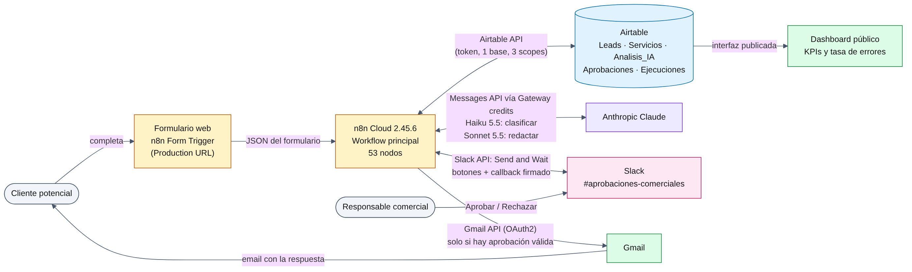
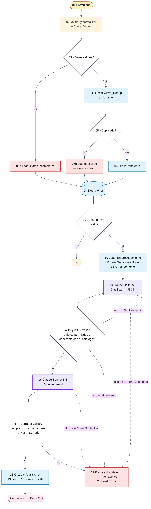
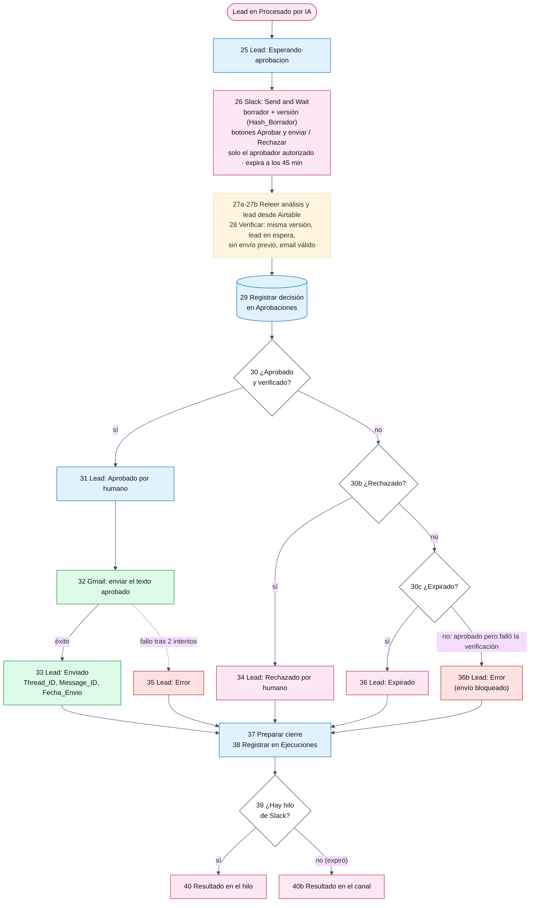

# Arquitectura y flujo

> Estado: **Configurado, ejecutado y validado** (workflow publicado como versión `v1.0 - Entrega final` en n8n Cloud 2.45.6).
> Archivo técnico: [`workflow/datapyme-consultas-comerciales.json`](../workflow/datapyme-consultas-comerciales.json) (53 nodos, exportado desde n8n).

## 1. Arquitectura general

| Componente | Función | Qué intercambia | Autenticación | Limitación / costo |
|---|---|---|---|---|
| **n8n Cloud** | Orquestador: trigger, lógica, reintentos, rutas de error, espera de aprobación | JSON entre nodos | Cuenta de n8n | Prueba de 14 días, 1.000 ejecuciones de producción |
| **Airtable** | Memoria y registro: 5 tablas relacionadas, catálogo de servicios, dashboard | Registros (lectura y escritura) | Token personal con 3 scopes y acceso a **una sola base**; dominio restringido a `api.airtable.com` | Plan gratuito: 1.000 registros por base |
| **Anthropic Claude** | Clasificar la consulta (Haiku 5.5) y redactar la respuesta (Sonnet 5.5) | Prompt estructurado → JSON | Gateway credits de n8n Cloud (sin API key propia en el entorno académico) | Pago por token (ver matriz de costos) |
| **Slack** | Punto de aprobación humana (HITL) y avisos del resultado | Mensaje con botones → decisión + quién respondió | Token de bot con 5 scopes + *signing secret* para verificar cada clic; dominio restringido a `slack.com` | Requiere que n8n sea accesible por HTTPS público |
| **Gmail** | Canal de salida al cliente | Email de texto | OAuth2 (gestionado por n8n) | Límites de envío de la cuenta |

Se integran **5 tecnologías** (la consigna pide al menos 4): orquestador, base de datos, IA y dos canales (Slack interno y Gmail externo).

## 2. Flujo — Parte A y B: recepción y procesamiento con IA

| # | Nodo | Entrada | Salida | Errores contemplados |
|---|---|---|---|---|
| 01 | Form: Nueva consulta | Envío del formulario público | Nombre, Email, Empresa, Mensaje | — |
| 02 | Validar y normalizar (Code) | Datos crudos | Datos limpios, `es_valido`, lista de errores, `clave_dedup` | Nombre corto, email vacío o mal formado, mensaje < 20 o > 3.000 caracteres |
| 03 | ¿Datos válidos? | `es_valido` | Ruta normal o de datos incompletos | — |
| 03b–03c | Lead: Datos incompletos + log | Datos limpios | Lead en estado terminal `Datos incompletos` (el email inválido no se guarda) | — |
| 04 | Buscar duplicado | `clave_dedup` | Lead existente o vacío | `alwaysOutputData` para no cortar el flujo si no hay resultados |
| 05–05b | ¿Es duplicado? + log | Resultado de la búsqueda | Si existe, se registra `duplicado` y **no** se crea otro lead | — |
| 06–08 | Crear lead (Pendiente) + log | Datos limpios | Lead `Pendiente` y fila en `Ejecuciones` | — |
| 09 | ¿Lead nuevo válido? | Resultado del log | Solo los leads nuevos (`ok`) siguen a la IA | Duplicados e incompletos terminan acá |
| 10 | Lead: En procesamiento | ID del lead | Estado bloqueante | — |
| 11–12 | Traer servicios activos + Armar contexto | Tabla `Servicios` | Catálogo en texto + lista para validar | Catálogo vacío → error explícito |
| 13 | **Claude Haiku 5.5: Clasificar** | Catálogo + consulta | JSON de clasificación | 3 intentos automáticos; si falla, salida de error |
| 14–15b | Validar clasificación + 1 reintento | Respuesta del modelo | Clasificación validada o reintento | JSON inválido, valores no permitidos, servicio inexistente, inconsistencia con el catálogo |
| 16 | **Claude Sonnet 5.5: Redactar** | Consulta + clasificación + servicio | JSON con asunto y cuerpo | 3 intentos automáticos; si falla, salida de error |
| 17–17b | Validar borrador y generar huella | Respuesta del modelo | Borrador validado + `Hash_Borrador` | Precios o monedas, marcadores, longitud fuera de rango |
| 18–20 | Guardar análisis + Lead: Procesado por IA + log | Borrador validado | Registro en `Analisis_IA`, lead actualizado | — |
| 22, 21, 23, 24 | Preparar log de error + Registrar + Lead: Error | Cualquier fallo de las ramas de IA | Lead en estado terminal `Error`, detalle en `Ejecuciones` | — |

## 3. Flujo — Parte C: aprobación humana y envío

| # | Nodo | Entrada | Salida | Errores contemplados |
|---|---|---|---|---|
| 25 | Lead: Esperando aprobacion | ID del lead | Estado bloqueante | — |
| 26 | **Slack: Solicitar aprobación** (Send and Wait) | Borrador, versión, datos del cliente | Decisión (`approved`), quién respondió, `messageId` del mensaje | Solo el usuario autorizado puede responder; expira a los 45 minutos |
| 27a–27b | Releer análisis y lead | IDs de Airtable | Datos actuales (no los de memoria) | — |
| 28 | Verificar decisión y versión (Code) | Decisión + datos releídos | `ruta`: enviar, rechazado, expirado o bloqueado | Borrador editado tras pedir la aprobación, lead fuera de estado, envío previo, email inválido |
| 29 | Registrar decisión (Aprobaciones) | Resultado de 28 | Registro en `Aprobaciones` con `Hash_Aprobado` | — |
| 30–30c | Enrutamiento | `ruta` | Una sola rama | — |
| 31–33 | Aprobado → Gmail → Enviado | Texto releído de Airtable | Email enviado, lead `Enviado` con `Thread_ID` y `Message_ID` | Gmail: 2 intentos; si falla, salida de error |
| 34 / 36 / 35 / 36b | Rechazado / Expirado / Error de envío / Envío bloqueado | — | Estado terminal del lead | — |
| 37–38 | Preparar cierre + Registrar ejecución | Rama ejecutada | Fila en `Ejecuciones` (`ok`, `error` o `bloqueado`) | — |
| 39–40b | Aviso en Slack | Resultado | Respuesta **en el hilo** del mensaje de aprobación (o en el canal si expiró) | — |

## 4. Trigger inteligente y protección contra bucles

- **Disparador:** formulario de n8n (webhook). Solo se ejecuta cuando alguien envía el formulario; no hay consultas periódicas que gasten ejecuciones.
- **Sin trigger de Airtable:** las escrituras del propio flujo en la base no pueden volver a dispararlo.
- **Idempotencia:** `Clave_Dedup` (huella de email + mensaje) impide procesar dos veces la misma consulta (prueba T02).
- **Máquina de estados:** cada paso solo avanza desde el estado esperado; los estados terminales (`Datos incompletos`, `Enviado`, `Rechazado por humano`, `Expirado`, `Error`) no se reprocesan.
- **Reintentos con tope:** 3 intentos por llamada a Claude, 1 reintento de clasificación inválida y 2 intentos de Gmail. No hay bucles abiertos.
- **Tipos de datos:** las comparaciones de los filtros usan el mismo tipo (booleano con booleano, texto con texto); los campos numéricos de Airtable (`Intentos_IA`, `Tokens_*`) son de tipo Number.

## 5. ¿Por qué no RAG vectorial?

La IA necesita dos fuentes: el **catálogo de servicios** (5 registros estructurados) y la **consulta** del cliente. El catálogo completo entra en el prompt con holgura, así que una búsqueda semántica no mejoraría la respuesta y sumaría un componente más que mantener y que podría fallar. Se usa **recuperación estructurada desde Airtable**: el nodo 11 lee solo los servicios activos y el nodo 14 verifica que el servicio que sugiere la IA exista en ese catálogo. Si el catálogo creciera a decenas de servicios con descripciones largas, el siguiente paso sería RAG con embeddings.
